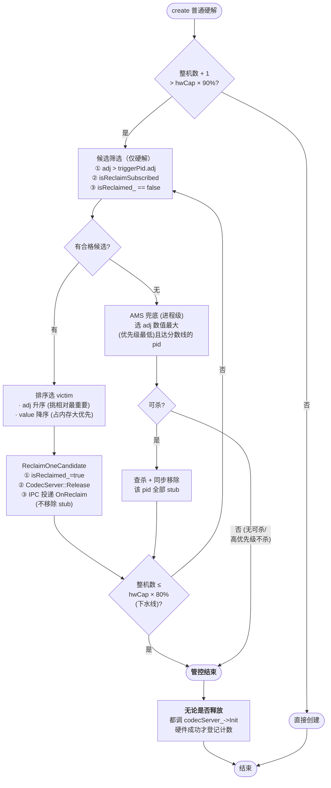
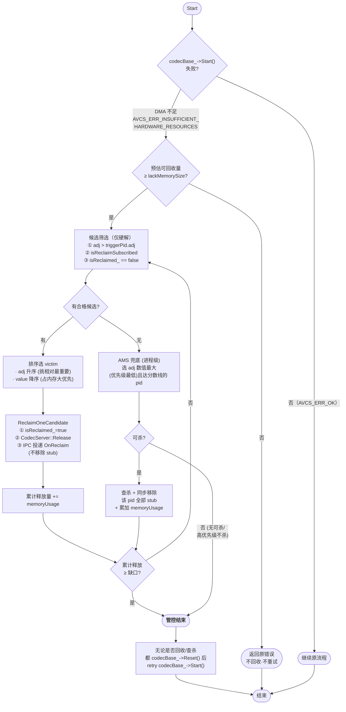
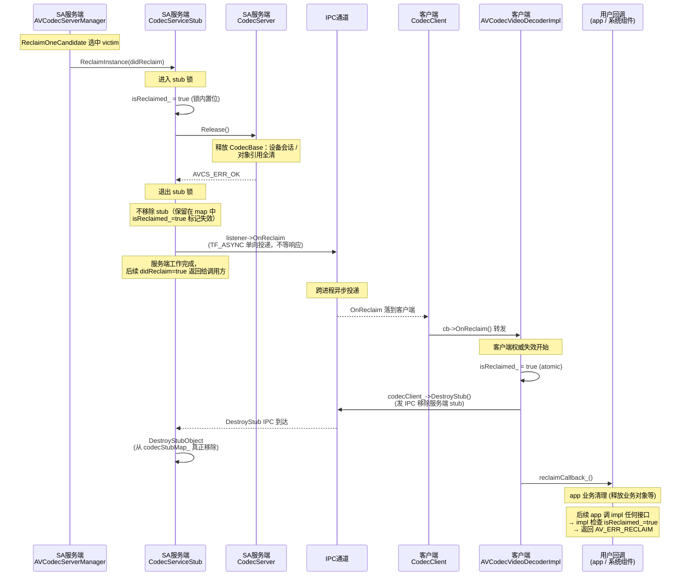
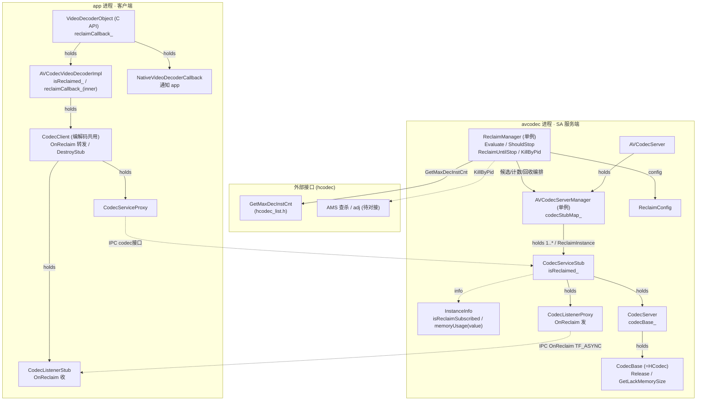
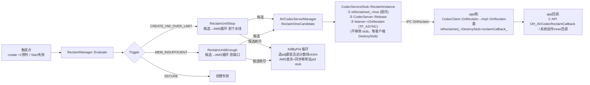

# 解码实例回收实现方案

> 需求来源：[资源回收.md](./资源回收.md) · 适用范围：仅视频解码实例 · 代码为实现参考，外部待对接接口以注释标明。

## 1. 背景、范围与术语

内存压力、硬解实例数接近上限时释放解码资源。已接入回收机制的实例优先回调通知应用；不足时 AMS 以进程为单位兜底。

| 术语 | 含义 |
| --- | --- |
| 实例回收 | 对某个解码实例执行释放；只有已注册回收回调的实例进入该路径 |
| AMS 兜底 | 按 pid 查杀进程，不精确到实例，不受订阅限制 |
| value | 实例在 av_codec 进程中的内存占用 = `InstanceInfo.memoryUsage`，越大越优先 |

## 2. 需求与验收规则

### 2.1 整机规则

| 管控问题 | 触发场景 | 规则 |
| --- | --- | --- |
| 硬解实例数超过能力查询上限的 90%（上水线） | create | 按候选规则回收到 80%（下水线）；不足按 adj 调 AMS 查杀（只杀达分数线的进程）；到不了下水线则直接退出，回收/查杀后尝试创建（不强制要求有释放） |
| 安全硬解实例数达到能力查询上限 | create | 不回收、不查杀，创建失败 |
| 内存不足（DMA） | start 失败 | 先预估可回收量；预估不足直接退出报错；预估足够时按 adj/value 回收硬解候选，不足 AMS 查杀；回收后重试 |

#### 场景一：create 普通硬解（整机水位触发）

**触发条件**：`create` 时 `整机数 + 1 > hwCap × 90%`（上水线）
**回收目标**：把整机硬解实例数压到 `hwCap × 80%`（下水线）



#### 场景三：Start 失败 DMA 内存不足

**触发条件**：`Start()` 返回 `AVCS_ERR_INSUFFICIENT_HARDWARE_RESOURCES`（DMA buffer 分配失败）
**回收目标**：累计释放的 memory 总量 ≥ `lackMemorySize`（内存缺口）
**候选范围**：仅硬解/安全硬解，软解不纳入候选



#### 单实例回收执行（跨进程协作）

流程图里的 `REC` 节点展开如下，覆盖 SA 服务端、IPC 通道、app 客户端三方的完整动作：



## 3. API 接口

### 3.1 新增 C API

#### 中文版

```cpp
// interfaces/kits/c/native_avcodec_videodecoder.h  新增
/**
 * @brief 当 OH_AVCodec 实例因资源压力被系统回收时，该函数指针将被调用。
 *
 * 该回调被调用后，除 {@link OH_VideoDecoder_Destroy}
 * 能被正常调用外，对该 codec 的任意其他接口调用将返回 {@link AV_ERR_RECLAIM}。
 * 用户在接受回调后需及时释放业务对象；如仍需解码，请重新创建解码器实例。
 *
 * @param codec OH_AVCodec 实例
 * @param userData 用户用于执行回调的数据。
 * @since 26.1.0
 */
typedef void (*OH_AVCodecReclaimCallback)(OH_AVCodec *codec, void *userData);

/**
 * @brief 为视频解码器注册回收回调，使应用在解码实例被系统回收时能够收到通知。
 * 本接口必须在 Prepare 之前调用。
 *
 * 仅注册了回收回调的实例才会进入回收候选并经回调通知。
 *
 * @param codec 指向 OH_AVCodec 实例的指针
 * @param callback 回调函数指针，见 {@link OH_AVCodecReclaimCallback}
 * @param userData 用户用于执行回调的数据
 * @return 执行成功返回 AV_ERR_OK，
 * 否则返回具体错误码，见 {@link OH_AVErrCode}。
 * {@link AV_ERR_RECLAIM}，实例已被系统回收。
 * {@link AV_ERR_INVALID_VAL}
 * 1. 传入的 codec 指针非解码器实例或为 NULL；
 * 2. callback 为 NULL。
 * {@link AV_ERR_OPERATE_NOT_PERMIT}，内部执行错误。
 * @since 26.1.0
 */
OH_AVErrCode OH_VideoDecoder_RegisterReclaimCallback(OH_AVCodec *codec,
    OH_AVCodecReclaimCallback callback, void *userData);
```

```cpp
// interfaces/kits/c/native_averrors.h  新增错误码
/**
 * @brief 解码实例已被系统回收。
 * @syscap SystemCapability.Multimedia.Media.VideoDecoder
 * @since 26.1.0
 */
AV_ERR_RECLAIM = 13;
```

#### 英文版

```cpp
// interfaces/kits/c/native_avcodec_videodecoder.h  新增
/**
 * @brief Called when the OH_AVCodec instance is reclaimed by the system due to resource pressure, and this function pointer will be invoked.
 *
 * Once this callback is invoked, any subsequent call on this codec will return {@link AV_ERR_RECLAIM},
 * except {@link OH_VideoDecoder_Destroy}, which can still be called normally. The user should promptly
 * release business objects after receiving the callback; if decoding is still needed, create a new decoder instance.
 *
 * @param codec OH_AVCodec instance
 * @param userData The data that the user rely on to execute the callback.
 * @since 26.1.0
 */
typedef void (*OH_AVCodecReclaimCallback)(OH_AVCodec *codec, void *userData);

/**
 * @brief Register a reclaim callback for the video decoder so that the application can be notified when
 * the decoder instance is reclaimed by the system. This interface must be called before Prepare is called.
 *
 * Only instances that have registered a reclaim callback will be selected as reclaim candidates and
 * notified via the callback.
 *
 * @param codec Pointer to an OH_AVCodec instance
 * @param callback Reclaim callback, see {@link OH_AVCodecReclaimCallback}
 * @param userData The data that the user rely on to execute the callback
 * @return Returns AV_ERR_OK if the execution is successful,
 * otherwise returns a specific error code, refer to {@link OH_AVErrCode}.
 * {@link AV_ERR_RECLAIM}, the instance has been reclaimed by the system.
 * {@link AV_ERR_INVALID_VAL}
 * 1. the input codec pointer is non decoder instance or NULL;
 * 2. callback is NULL.
 * {@link AV_ERR_OPERATE_NOT_PERMIT}, internal execution error.
 * @since 26.1.0
 */
OH_AVErrCode OH_VideoDecoder_RegisterReclaimCallback(OH_AVCodec *codec,
    OH_AVCodecReclaimCallback callback, void *userData);
```

```cpp
// interfaces/kits/c/native_averrors.h  新增错误码
/**
 * @brief The codec instance has been reclaimed by the system.
 * @syscap SystemCapability.Multimedia.Media.VideoDecoder
 * @since 26.1.0
 */
AV_ERR_RECLAIM = 13;
```

- 落地时既有解码接口（除 `OH_VideoDecoder_Destroy` 外）需在各自 `@return` 增列 `AV_ERR_RECLAIM`；返回指针的接口（`GetOutputDescription`/`GetInputBuffer`/`GetOutputBuffer`）按无效返回 NULL；

### 3.2 开发者调用示例（伪代码）

```cpp
// ---- C API 开发者使用范式 ----

// 1. 创建解码器
OH_AVCodec *codec = OH_VideoDecoder_CreateByName("avc_hw_decoder");
// 或：OH_VideoDecoder_CreateByMime(OH_AVCODEC_MIMETYPE_VIDEO_AVC);

// 2. 注册回收回调（须在 Prepare 之前注册）
void OnReclaimed(OH_AVCodec *codec, void *userData) {
    // 此回调在回收完成后被调用
    // 开发者职责：释放业务对象，不再对该 codec 调用解码相关接口（OH_VideoDecoder_Destroy 除外）
    // 后续对该 codec 的任何其他接口调用（OH_VideoDecoder_Destroy 除外）将返回 AV_ERR_RECLAIM
    MyContext *ctx = (MyContext *)userData;
    ctx->isReclaimed = true;
    // 通知业务线程停止解码相关操作...
}

OH_AVErrCode ret = OH_VideoDecoder_RegisterReclaimCallback(codec, OnReclaimed, &myContext);
if (ret != AV_ERR_OK) {
    // 注册失败，该实例不会被回收（不进候选），但不影响正常解码
}

// 3. 正常使用 Configure / Start / QueueInputBuffer / ReleaseOutputBuffer ...

// 4. 如果收到 OnReclaimed 回调：
//    - 不要再调用该 codec 的任何接口（均返回 AV_ERR_RECLAIM）
//    - 释放业务对象，如需要解码则重新 CreateByName/CreateByMime

// 5. 正常结束时调 OH_VideoDecoder_Destroy(codec)
//    注意：已被回收的 codec 调 Destroy 也是安全的（幂等），这是回收后唯一仍能被正常调用的接口
```

## 4. 总体流程

```text
create / start 失败
    │
    ▼
 ReclaimManager::Evaluate(trigger, ctx)
    │ 传入回收条件（pid/计数/缺口/触发类型）
    ▼
 AVCodecServerManager ── codecStubMap_
    │ static_pointer_cast<CodecServiceStub>
    ▼
 CodecServiceStub::ReclaimInstance
    │ 标记失效 + 释放 + 投递 OnReclaim + 移除
    ▼
 不足时 → AMS 按 pid 查杀（达分数线）
```

职责：`CodecServiceStub` 负责回收标记；`CodecServer` 负责底层释放；codec 创建流程负责计算创建后的实例数并判断是否超限；`AVCodecServerManager` 遍历/选择/执行回收，返回结果，不维护候选列表；`ReclaimManager` 只根据已确认的触发原因编排回收、重试和 AMS 兜底，不做超限预判。

### 4.1 类关系与进程边界



### 4.2 回收调用链



## 5. 代码实现

### 5.1 InstanceInfo 扩展

```cpp
// services/services/common/instance_info.h
struct InstanceInfo {
    // 原有字段：instanceId / caller / forwardCaller / codecType / memoryUsage / codecName
    //           codecCreateTime / videoCodecType / codecParam ...
    bool isReclaimSubscribed = false;  // 注册过 ReclaimCallback
    // memoryUsage 即实例 value
};
```

### 5.2 ReclaimConfig

```cpp
// services/services/common/reclaim_manager/reclaim_config.h
struct ReclaimConfig {
    double   hwDecoderHighWatermark = 0.9; // 整机硬解触发比例（相对能力查询上限，上水线）
    double   hwDecoderReclaimTarget = 0.8; // 整机硬解回收目标（相对能力查询上限，下水线）
    // 整机硬解总上限复用 hcodec_list.h::GetMaxDecInstCnt() 运行时获取；安全硬解上限待对接，不在此处
};
```

### 5.3 CodecServiceStub 回收标记

`isReclaimed_` 放在 `CodecServiceStub`，回收在 stub 锁下线性化。

```cpp
// services/services/codec/ipc/codec_service_stub.h  新增成员
class CodecServiceStub : public IRemoteStub<IStandardCodecService>, ... {
public:
    int32_t ReclaimInstance(bool &didReclaim);        // 服务端内部入口（非 app IPC）
    bool IsReclaimable();                              // 回收前状态检查
private:
    bool isReclaimed_ = false;
};
```

```cpp
// services/services/codec/ipc/codec_service_stub.cpp
#define CHECK_RECLAIMED() CHECK_AND_RETURN_RET_LOG_WITH_TAG(isReclaimed_, AV_ERR_RECLAIM, "reclaimed")

// app-facing 接口范式：用 CHECK_RECLAIMED 宏
int32_t CodecServiceStub::Configure(const Format &format) {
    std::lock_guard<std::shared_mutex> lock(mutex_);
    CHECK_RECLAIMED();  // 防 OnRemoteRequest 放锁后竞态 + 防访问已释放 codecServer_
    CHECK_AND_RETURN_RET_LOG_WITH_TAG(codecServer_ != nullptr, AVCS_ERR_NO_MEMORY, "Codec server is nullptr");
    return codecServer_->Configure(format);
}
// 说明：memberFunc 内 CHECK_RECLAIMED 不可省——ReclaimInstance 会释放 codecServer_ 底层资源，
// 不检查直接访问会崩溃。
```

### 5.4 ReclaimManager（评估与编排）

```cpp
// services/services/common/reclaim_manager/reclaim_manager.h
class ReclaimManager {
public:
    static ReclaimManager &GetInstance();
    enum class Trigger {
        CREATE_HW_OVER_LIMIT,        // 创建普通硬解实例时，整机硬解实例数超过触发比例
        CREATE_SECURE_HW_OVER_LIMIT, // 创建安全硬解实例时，安全硬解实例数达到能力上限
        MEM_INSUFFICIENT,            // 内存不足（DMA）
    };
    struct EvaluateContext {
        pid_t callerPid = -1;
        uint32_t lackMemorySize = 0;  // 内存不足时的缺口（字节），仅 MEM_INSUFFICIENT 用
    };
    bool Evaluate(Trigger trigger, const EvaluateContext &ctx);  // 返回是否实际释放
    const ReclaimConfig &GetConfig() { return config_; }  // 供 codec 层做 +1 预判
    bool KillByPid(pid_t triggerPid, uint32_t &freedMem);  // 选 adj 最低且达分数线的 victim 查杀并同步移除该 pid 全部 stub，out 该 pid memoryUsage；受限返回 false
private:
    ReclaimManager() = default;
    ReclaimConfig config_;
    std::mutex evalLock_;            // 串行化同步回收编排
    bool ShouldStop(Trigger trigger);  // 是否达目标水位
    bool ReclaimUntilStop(Trigger trigger, pid_t triggerPid);   // 循环回收到目标水位，不足 AMS 兜底
    bool ReclaimUntilEnough(const EvaluateContext &ctx);       // 循环回收到缺口满足，不足 AMS 兜底
};
```

```cpp
// services/services/common/reclaim_manager/reclaim_manager.cpp
bool ReclaimManager::Evaluate(Trigger trigger, const EvaluateContext &ctx) {
    std::lock_guard<std::mutex> lg(evalLock_);
    auto &mgr = AVCodecServerManager::GetInstance();
    switch (trigger) {
        case Trigger::CREATE_HW_OVER_LIMIT: {
            // codec 层已确认创建普通硬解会导致整机硬解超触发比例：循环回收到目标水线
            // 拿 evalLock_ 前触发点的 +1 判断与现在之间存在窗口，期间别的回收（前一个串行回收、MEM_INSUFFICIENT 候选）可能已把整机硬解数降下来。
            // 复核 create 后是否仍超上水线，不超则无需再压到下水线，避免过度回收。
            // 复核口径与触发点一致带 +1（create 尚未登记）；与补26「不做 +1 预判」不冲突——
            // 补26 指触发判断由 codec 层做，这里是拿锁后复核触发条件是否仍成立。
            uint32_t hwCap = GetMaxDecInstCnt();
            if (mgr.CountTotalHwDec() + 1 <= static_cast<uint32_t>(hwCap * config_.hwDecoderHighWatermark)) {
                return false;
            }
            return ReclaimUntilStop(trigger, ctx.callerPid);
        }
        case Trigger::CREATE_SECURE_HW_OVER_LIMIT:
            // 创建安全硬解时达到能力上限：不回收、不查杀，创建失败
            return false;
        case Trigger::MEM_INSUFFICIENT:
            // 内存不足：先预估可回收量，不够直接退出报错；够才循环回收到缺口满足
            if (mgr.EstimateReclaimableMemory(ctx.callerPid) < ctx.lackMemorySize) return false;
            return ReclaimUntilEnough(ctx);
        default:
            return false;
    }
}

// 循环回收直到达目标水位或候选耗尽；候选耗尽后 AMS 循环查杀到水位/受限，不强制到下水线
bool ReclaimManager::ReclaimUntilStop(Trigger trigger, pid_t triggerPid) {
    auto &mgr = AVCodecServerManager::GetInstance();
    bool reclaimed = false;
    while (!ShouldStop(trigger)) {
        uint32_t freed = 0;
        if (!mgr.ReclaimOneCandidate(triggerPid, freed)) break;  // 候选耗尽
        reclaimed = true;
    }
    while (!ShouldStop(trigger)) {  // 候选耗尽，AMS 兜底循环查杀
        uint32_t freed = 0;
        if (!KillByPid(triggerPid, freed)) break;  // 受限（达分数线的耗尽/更高优先级）退出
        reclaimed = true;
    }
    return reclaimed;
}

// 循环回收到累计释放量 >= 缺口或候选耗尽；候选耗尽后 AMS 循环查杀到满足/受限，不强制到缺口
bool ReclaimManager::ReclaimUntilEnough(const EvaluateContext &ctx) {
    auto &mgr = AVCodecServerManager::GetInstance();
    uint32_t freed = 0;
    bool reclaimed = false;
    while (freed < ctx.lackMemorySize) {
        uint32_t one = 0;
        if (!mgr.ReclaimOneCandidate(ctx.callerPid, one)) break;
        freed += one;
        reclaimed = true;
    }
    while (freed < ctx.lackMemorySize) {  // 候选耗尽，AMS 兜底循环查杀
        uint32_t one = 0;
        if (!KillByPid(ctx.callerPid, one)) break;  // 受限退出
        freed += one;
        reclaimed = true;
    }
    return reclaimed;
}

// 是否达目标水位：整机超限看 hwDecoderReclaimTarget
bool ReclaimManager::ShouldStop(Trigger trigger) {
    auto &mgr = AVCodecServerManager::GetInstance();
    if (trigger == Trigger::CREATE_HW_OVER_LIMIT) {
        uint32_t hwCap = GetMaxDecInstCnt();
        return mgr.CountTotalHwDec() <= static_cast<uint32_t>(hwCap * config_.hwDecoderReclaimTarget);
    }
    return true;
}
```

### 5.5 AVCodecServerManager（候选选择与回收执行）

```cpp
// services/services/sa_avcodec/server/include/avcodec_server_manager.h  新增
class AVCodecServerManager {
public:
    uint32_t CountTotalHwDec();
    // 整机候选：按规则选一个低于当前优先级的订阅实例回收；out 释放的内存量
    bool ReclaimOneCandidate(pid_t triggerPid, uint32_t &freedMem);
    uint64_t EstimateReclaimableMemory(pid_t triggerPid);  // 只读预估可回收量
private:
    bool IsLowerPriority(pid_t pid, pid_t triggerPid);  // adj 接口待提供
    uint32_t GetMemoryUsage(const sptr<IRemoteObject> &obj);  // 从 obj 反查 InstanceInfo.memoryUsage
};
```

```cpp
// services/services/sa_avcodec/server/avcodec_server_manager.cpp
uint32_t AVCodecServerManager::CountTotalHwDec() {
    std::shared_lock<std::shared_mutex> lock(mutex_);
    uint32_t cnt = 0;
    for (auto &item : codecStubMap_) {
        if (item.second.second.videoCodecType == VideoCodecType::DECODER_HARDWARE) {
            ++cnt;
        }
    }
    return cnt;
}

// 只读预估硬解候选实例的可释放内存，不执行回收。
uint64_t AVCodecServerManager::EstimateReclaimableMemory(pid_t triggerPid) {
    std::shared_lock<std::shared_mutex> lock(mutex_);
    uint64_t total = 0;
    for (auto &item : codecStubMap_) {
        pid_t pid = item.first;
        auto &info = item.second.second;
        if (pid == triggerPid || !info.isReclaimSubscribed ||
            info.videoCodecType == VideoCodecType::DECODER_SOFTWARE ||  // 软解不纳入候选
            !IsLowerPriority(pid, triggerPid)) {
            continue;
        }
        total += info.memoryUsage;
    }
    return total;
}

// 整机候选：按规则选一个低于当前优先级的订阅实例回收；out 释放的内存量。循环编排和 AMS 兜底由 ReclaimManager 负责
bool AVCodecServerManager::ReclaimOneCandidate(
    pid_t triggerPid, uint32_t &freedMem) {
    std::vector<std::pair<sptr<IRemoteObject>, VideoCodecType>> cand;
    {
        std::shared_lock<std::shared_mutex> lock(mutex_);
        for (auto &item : codecStubMap_) {
            pid_t pid = item.first;
            auto &info = item.second.second;
            if (pid == triggerPid) continue;             // 当前进程不参与整机候选
            if (!info.isReclaimSubscribed) continue;      // 只选订阅实例
            if (info.videoCodecType == VideoCodecType::DECODER_SOFTWARE) continue;  // 软解不纳入候选
            if (!IsLowerPriority(pid, triggerPid)) continue;  // 优先级低于当前，adj 待对接
            cand.emplace_back(item.second.first, info.videoCodecType);
        }
        // 排序：adj 升序 → value 降序（仅硬解/安全硬解，软解不纳入候选）
        std::sort(cand.begin(), cand.end(), [this](auto &a, auto &b) {
            return GetMemoryUsage(a.first) > GetMemoryUsage(b.first);
        });
    }
    for (auto &candidate : cand) {
        auto stub = static_pointer_cast<CodecServiceStub>(candidate.first);
        if (!stub->IsReclaimable()) continue;             // 二次检查，跳过已失效实例
        freedMem = GetMemoryUsage(candidate.first);      // 回收前记录实例内存
        bool didReclaim = false;
        if (stub->ReclaimInstance(didReclaim) != AVCS_ERR_OK || !didReclaim) {
            continue;                                    // 已被其他路径回收，尝试下一个
        }
        return true;
    }
    return false;
}
```

### 5.6 触发点调用

触发点调用（create / Start 失败）：

```cpp
// services/services/codec/ipc/codec_service_stub.cpp  create 触发点（+1 预判）
int32_t CodecServiceStub::Init(AVCodecType type, bool isMimeType, const std::string &name, Meta &callerInfo) {
    std::lock_guard<std::shared_mutex> lock(mutex_);
    CHECK_AND_RETURN_RET_LOG_WITH_TAG(codecServer_ != nullptr, AVCS_ERR_NO_MEMORY, "Codec server is nullptr");
    if (IsHardwareTarget(type, name)) {  // 硬解判定沿用现有 name/能力查询
        pid_t callerPid = IPCSkeleton::GetCallingPid();
        auto &mgr = AVCodecServerManager::GetInstance();
        auto &rm = ReclaimManager::GetInstance();
        ReclaimManager::EvaluateContext ctx{callerPid, 0};
        // 整机硬解实例数 currentCount + 1 判断创建成功后是否超触发比例
        uint32_t hwCap = GetMaxDecInstCnt();
        if (mgr.CountTotalHwDec() + 1 > static_cast<uint32_t>(hwCap * rm.GetConfig().hwDecoderHighWatermark)) {
            // 整机硬解超触发比例：回收/查杀后无论是否释放都尝试创建
            rm.Evaluate(ReclaimManager::Trigger::CREATE_HW_OVER_LIMIT, ctx);
        }
    }
    // 评估后创建硬解 codecBase（成功才登记计数，失败不计）
    return codecServer_->Init(type, isMimeType, name, callerInfo);
}
```

```cpp
// services/services/codec/server/video/codec_server.cpp  Start 触发点
int32_t CodecServer::Start() {
    // ... 原有逻辑 ...
    int32_t ret = codecBase_->Start();
    if (ret == AVCS_ERR_INSUFFICIENT_HARDWARE_RESOURCES) {  // DMA/内存不足：预估+回收+重试
        uint32_t lack = codecBase_->GetLackMemorySize();     // 新增接口，插件实现
        ReclaimManager::EvaluateContext ctx{caller_.pid, lack};
        ReclaimManager::GetInstance().Evaluate(ReclaimManager::Trigger::MEM_INSUFFICIENT, ctx);  // 无论是否回收成功
        codecBase_->Reset();                                   // 先 Reset 再重试
        ret = codecBase_->Start();
    }
    return ret;
}
```

### 5.7 并行处理与防重复回收

- 异常场景：create 与 MEM_INSUFFICIENT 候选同时选中同一实例；回收中实例被另一场景选中；实例刚被 `Release` 又被选中。
- `ReclaimInstance` 以 stub 锁和 `isReclaimed_` 做线性化与幂等保护。
- `ReclaimOneCandidate` 回收前二次检查 `IsReclaimable()`；失效或已被其他路径回收的候选跳过并继续尝试下一个。
- 同步回收编排由 `evalLock_` 串行化。

### 5.8 服务端：CodecServiceStub::ReclaimInstance

```cpp
// services/services/codec/ipc/codec_service_stub.cpp
int32_t CodecServiceStub::ReclaimInstance(bool &didReclaim) {
    didReclaim = false;
    {
        std::lock_guard<std::shared_mutex> lg(mutex_);  // stub 锁 = 并发线性化点
        if (isReclaimed_) return AVCS_ERR_OK;             // 已被其他路径回收
        isReclaimed_ = true;                              // 标记：此后 app 请求返回 AV_ERR_RECLAIM
        didReclaim = true;
        if (codecServer_ != nullptr) {
            auto cs = std::static_pointer_cast<CodecServer>(codecServer_);
            cs->Release();  // 直接销毁实例；含已挂起态（Release 统一处理底层资源释放，不再先 NotifyMemoryRecycle/Stop）
        }
    }
    // 不在此移除 stub：stub 保留在 codecStubMap_ 中（isReclaimed_=true 标记失效），
    // 等客户端收到 OnReclaim 后主动调 DestroyStub() IPC 来移除（正常路径）；
    // 客户端无响应时由 remote death / TTL 兜底移除（异常路径）。
    if (listener_ != nullptr) {
        listener_->OnReclaim();  // stub 未移除，listener_ 仍有效；TF_ASYNC 单向，不等待 app
    }
    return AVCS_ERR_OK;
}

bool CodecServiceStub::IsReclaimable() {
    std::lock_guard<std::shared_mutex> lock(mutex_);
    return !isReclaimed_;
}
```

### 5.9 客户端：收到 OnReclaim（失效逻辑放 `AVCodecVideoDecoderImpl`）

失效逻辑下沉到 inner API 客户端 `AVCodecVideoDecoderImpl`，C API 与系统组件复用；`CodecClient` 是编解码共用 IPC 通道，只收 listener 事件转发 + 发 `DestroyStub` IPC，不承载 video decoder 专属失效语义（不污染编解码共用层）。

```cpp
// frameworks/native/avcodec/avcodec_video_decoder_impl.{h,cpp}  新增
class AVCodecVideoDecoderImpl : ... {
    void OnReclaim();                       // 由 CodecClient 经 callback 上报
    bool IsReclaimed() const { return isReclaimed_.load(); }
private:
    std::atomic<bool> isReclaimed_{false};
    std::function<void()> reclaimCallback_;  // 系统组件注册的 inner 回调
};
int32_t AVCodecVideoDecoderImpl::Start() {                 // 各接口入口检查（权威检查在 impl）
    if (isReclaimed_.load()) return AVCS_ERR_RECLAIM;
    return codecClient_->Start();
}
void AVCodecVideoDecoderImpl::OnReclaim() {                 // 编排：置失效 → Release → 上层回调
    isReclaimed_.store(true);
    codecClient_->Release();                            // 发 IPC，服务端调 DestroyStubObject 真正移除 stub
    if (reclaimCallback_) reclaimCallback_();
}
```

```cpp
// services/services/codec/client/codec_client.cpp  CodecClient 只转发 + 提供 IPC
void CodecClient::OnReclaim() {                             // 新增 MediaCodecCallback::OnReclaim
    auto cb = callback_;
    if (cb != nullptr) cb->OnReclaim();                     // 转发给 AVCodecVideoDecoderImpl
}
// DestroyStub 经 codecProxy_ 发 IPC（已有或新增）
```

```cpp
// frameworks/native/capi/avcodec/native_video_decoder.cpp  C API 只存回调 + 转发，失效/DestroyStub/入口检查由 impl 统一
struct VideoDecoderObject : public OH_AVCodec {
    std::shared_ptr<AVCodecVideoDecoder> videoDecoder_;
    OH_AVCodecReclaimCallback reclaimCallback_ = nullptr;
    void *reclaimUserData_ = nullptr;
};
void NativeVideoDecoderCallback::OnReclaim() {
    // impl::OnReclaim 已完成置失效+DestroyStub，这里只通知 app
    if (videoDecoderObject_->reclaimCallback_) {
        videoDecoderObject_->reclaimCallback_(codec_, videoDecoderObject_->reclaimUserData_);
    }
}
// C API 入口（Start 等）直接调 videoDecoder_->Start()，由 impl 入口检查 isReclaimed_ 返回 AV_ERR_RECLAIM，C API 不重复
```

系统组件用 `AVCodecVideoDecoder`，`SetReclaimCallback` 注册 inner 回调；收到 `OnReclaim` 时 `AVCodecVideoDecoderImpl` 已完成失效+`DestroyStub`，组件回调里做业务清理。权威失效检查在 `AVCodecVideoDecoderImpl` 各接口入口（`Start` 等）：C API 与系统组件都经 impl，impl 检查 `isReclaimed_` 返回 `AV_ERR_RECLAIM`，C API 不持有失效标志、不重复检查。

### 5.10 失效 stub 清理兜底

- 正常：`ReclaimInstance` 置 `isReclaimed_=true` + Release + 投递 `OnReclaim` → client 收到后调 `DestroyStub` IPC → 服务端 `DestroyStubObject` 真正移除 stub；
- app 死亡：remote death 清理；
- 未清理：有限 TTL 或数量上限，超限服务端强制清理（不影响已释放的底层资源）；
- 超兜底期限后不再保证返回 `AV_ERR_RECLAIM`，服务稳定性优先；
- 不新增 `ReclaimAck`、`ReclaimNotifyTask` 或通用决策线程。

### 5.11 回调 IPC 链路

```text
CodecServer::videoCb_
  → CodecListenerCallback::OnReclaim
  → IStandardCodecListener::OnReclaim
  → CodecListenerProxy::OnReclaim
  → Remote()->SendRequest(ON_RECLAIM, ..., MessageOption::TF_ASYNC)
  → app 侧 CodecListenerStub → CodecClient（转发）→ AVCodecVideoDecoderImpl（置失效+DestroyStub+上层回调）→ NativeVideoDecoderCallback/系统组件回调 → OH_AVCodecReclaimCallback
```

```cpp
// services/services/codec/ipc/codec_listener_proxy.cpp  新增
void CodecListenerProxy::OnReclaim() {
    MessageParcel data;
    MessageParcel reply;
    MessageOption option(MessageOption::TF_ASYNC);  // 单向，不等待 app
    data.WriteInterfaceToken(CodecListenerProxy::GetDescriptor());
    Remote()->SendRequest(static_cast<uint32_t>(CodecListenerInterfaceCode::ON_RECLAIM), data, reply, option);
}
```

新增 `IStandardCodecListener::OnReclaim`。

## 6. 外部依赖细节

- **缺口量**：`CodecBase` 新增抽象接口 `GetLackMemorySize()`，插件实现，细节不纳入方案
- **adj/AMS**：`IsLowerPriority`/`KillByPid` 依赖后续提供的 adj 接口（同时给 AMS 查杀分数线）；低于分数线不杀；具体 API/权限待提供
- **配置**：`ReclaimConfig` 见 5.2，均符号占位；整机硬解总上限复用 `hcodec_list.h::GetMaxDecInstCnt()`；安全硬解上限待对接

---